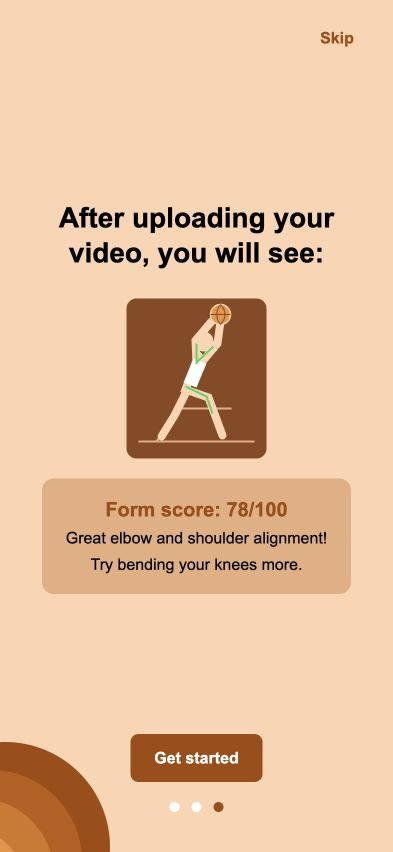

# NothingButNet

[](https://github.com/e-ayah/nothingbutnet/actions/workflows/tests.yml)

A basketball free-throw form-analysis app. Upload a side-view clip, review an annotated replay and elbow/knee/shoulder feedback, then compare your sessions over time.

<p align="center">
  
</p>

*An app onboarding preview; the score shown is illustrative, not an accuracy measurement.*

## Run it

Start with the [complete setup guide](docs/setup.md): Python 3.11, PostgreSQL 16, Node.js 20+, backend configuration, migrations, ML checks, then Expo on web or iPhone. The guide includes expected results and known blockers so a new contributor can distinguish setup problems from application defects.

```bash
# From the repository root, after completing setup:
source venv/bin/activate
cd backend
uvicorn main:app --reload --host 0.0.0.0
```

In a second terminal:

```bash
cd frontend
npm ci
npm start
```

Press **w** for web; scan the QR code with a compatible Expo Go build for iPhone. A phone must use your computer's LAN IP for the API, not `localhost`.

- [Web deployment](https://nothingbutnet-op.vercel.app) · [deployed API docs](https://nothingbutnet-0l0a.onrender.com/docs)
- These addresses are recorded in the deployment guides; availability and deployment parity are not guaranteed. The live schema responded on November 10, 2026 after earlier timeouts, but serves an older API; see the [verified deployment differences](docs/api-contract.md#verified-live-deployment-differences).

## What is implemented

| Area | State on `develop` at the Finals #08 audit |
|---|---|
| Account and startup | Login/signup screens, persistent authentication, first-launch onboarding, profile and username endpoints. Signup accepts the app’s flat JSON body, including an optional username; see [API contract](docs/api-contract.md#authentication). |
| Video analysis | Cloudinary upload, background analysis, session polling, annotated video, score and three angle checkpoints. Missing-shot detection marks the session failed with filming advice. |
| History and comparison | Session history/results screens and a two-shot comparison screen/endpoint. The comparison client still uses mocks; the server's real comparison has model-field mismatches. |
| Progress and insights | Progress endpoint and screen; progress and recurring-insight app calls still return mock data. The recurring endpoint needs a model-field fix. |
| Social | Username/friend request backend and made/missed patch endpoint are merged. Leaderboard, made/missed and comparison clients use mocks. Friends UI PR #103 was not yet merged; Friends/Leaderboard routes are not registered in the app. |
| Goals and feedback | Scaffold screens and ping routes only; goal CRUD and feedback submission are not implemented on the server. |

This is a working student prototype with integration work still in progress, not a claim that every screen is connected to real data. [Finals #01–#07](docs/writeups/project-writeup-draft.md#whats-left) own the remaining integrations, regression fixes and measurements.

## Stack and layout

- **App:** Expo SDK 58, React Native, TypeScript, NativeWind/Inter, React Navigation, Zustand; SecureStore on native and AsyncStorage on web.
- **API:** FastAPI, SQLAlchemy/Alembic, PostgreSQL, JWT/bcrypt authentication, Cloudinary video storage.
- **ML:** MediaPipe Pose 0.10.21, NumPy, OpenCV and FFmpeg; geometric angle measurements, release heuristic and rule-based scoring.
- **Hosting and checks:** Render API, Vercel web build, GitHub Actions with isolated ML/API jobs.

```text
frontend/     Expo app, screens, shared components and API clients
backend/      FastAPI routes, schemas, services, models and migrations
ml/           Video/pose pipeline, feedback rules, tools and tests
data/         Release-frame answer key (no original recordings)
docs/         Setup, architecture, API contract, designs and write-ups
testing/      Video references, beta checklist and historical reports
```

## Documentation and tests

- [Setup and troubleshooting](docs/setup.md)
- [Architecture and analysis flow](docs/architecture.md)
- [Implemented API contract and gaps](docs/api-contract.md)
- [Test guide](docs/testing.md) · [CI workflow](.github/workflows/tests.yml)
- [Project write-up draft](docs/writeups/project-writeup-draft.md)
- [API deployment](docs/deploy.md) · [web deployment](docs/deploy-web.md)

```bash
# In an activated Python 3.11 environment, from the repository root:
python -m pytest ml/tests -q
TEST_DATABASE_URL=postgresql://localhost/nothingbutnet_test \
  SECRET_KEY=local-test-only python -m pytest backend/tests -q
```

The backend suite recreates tables in `nothingbutnet_test`; never point it at a shared database. CI runs both full suites on every PR and pushes to `develop`, and retains JUnit reports even on failure. See the [verification record](docs/setup.md#verification-and-teammate-walkthrough) for observed results and unresolved failures; a badge reports current checks rather than promising success.

## Team and contributing

Built by the NothingButNet project team. PMs: Ayah and Navya. See [all contributors](https://github.com/e-ayah/nothingbutnet/graphs/contributors) for the implementation/design credits; the PMs will finalize the presentation's team roster.

Branch from the latest `develop`, follow your ticket's file ownership, and open a PR into `develop` with the ticket ID. A PM reviews/merges. Keep `.env`, credentials, local databases, generated videos, `venv/`, `node_modules/` and original player clips out of Git. Get consent and use the team's approved storage for recordings.
