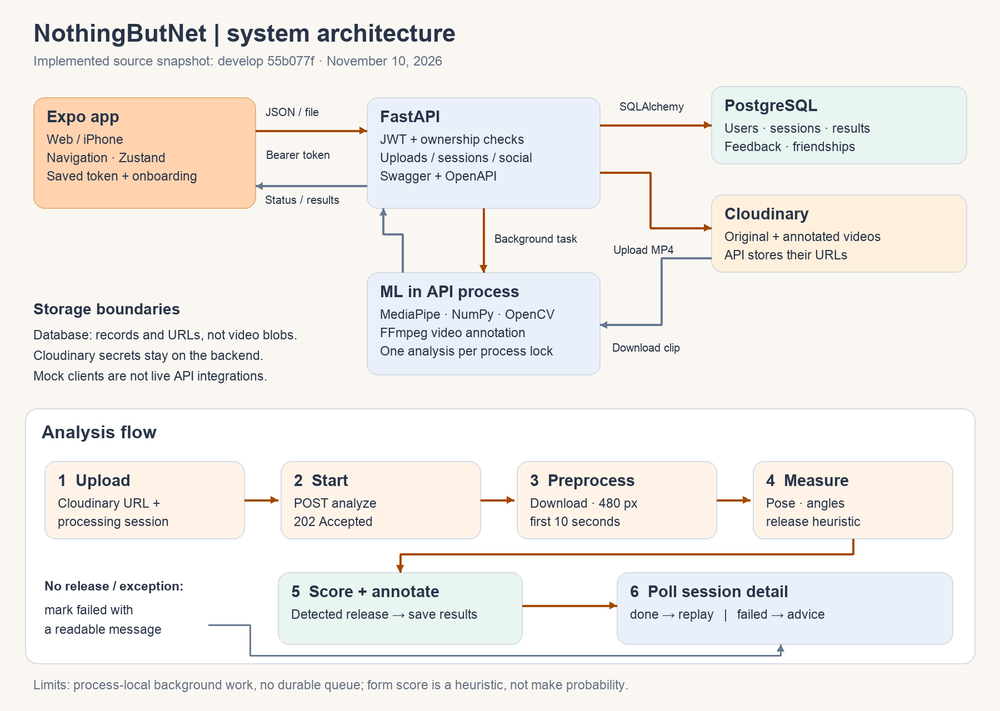
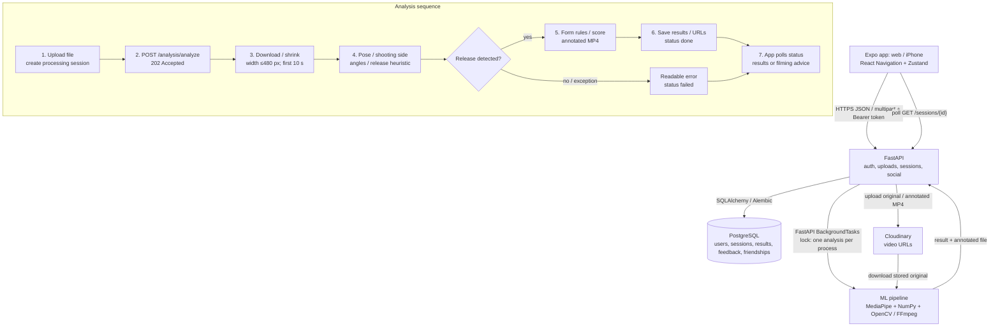

# System architecture

Snapshot: `develop` commit `55b077f`, audited November 10, 2026. Solid arrows show implemented connections; mock clients and pending routes are called out below. This diagram does not imply every frontend screen uses real data.

## Editable diagram

The Mermaid source preserves the structure for future updates; the PNG above is a standalone export for READMEs/slides.

## Components and boundaries

| Box | Responsibility and data |
|---|---|
| Expo app | Screens, NativeWind/Inter components, API requests and status polling. Zustand stores token/user; native storage uses SecureStore, web uses AsyncStorage. Onboarding completion is a separate AsyncStorage flag. |
| FastAPI | JWT authentication/ownership checks, multipart uploads, session/analysis coordination, progress, friends and comparison routes. Swagger/OpenAPI is generated by the running app. |
| PostgreSQL | `users`, `sessions`, `analysis_results`, `feedback_items`, `friendships` and a scaffold `goals` table. `sessions` holds score, original/annotated video URLs, status, error and nullable self-reported `made`. No video blobs are stored here. |
| Cloudinary | Hosts original uploads and annotated MP4s. Server-side credentials live in backend environment variables. The app receives URLs, not the API secret. |
| ML modules | Pose extraction, shooting-side detection, per-frame joint angles, heuristic release selection, rule-based form feedback, skeleton/angle overlays and FFmpeg video encoding. The standalone CLI works without the API/database. |
| GitHub Actions | Separate full ML/API test jobs. API uses disposable PostgreSQL 16; neither job needs production secrets or external video storage. |

## Analysis flow

1. Authenticated app sends multipart `file` to `POST /sessions/upload`. The API saves it to a temporary file, uploads it to Cloudinary, creates a processing session, and returns its ID and URL. Upload alone does not enqueue analysis.
2. App calls `POST /analysis/analyze` with `session_id` and required `video_url`. The server checks ownership, uses the **session's stored URL**, schedules a background task, and returns **202** with processing status.
3. The server downloads the clip and preprocesses it to at most 480 pixels wide and the first 10 seconds. This reduces processing cost; it is not the planned bad-video validator.
4. MediaPipe Pose supplies landmarks/visibility. The pipeline chooses the shooting side, calculates elbow/knee/shoulder angles and estimates release with a heuristic. It does not track ball-to-hoop outcomes.
5. If release is detected, inclusive angle ranges produce `good`/`needs_work` feedback and a 0–100 heuristic score. The renderer draws pose/angles and encodes an annotated MP4. The API uploads that output and writes analysis/feedback rows and the session score/URL.
6. The session becomes `done`, or `failed` with a readable error if release is missing or processing raises. The app polls session detail and renders results or a retry/filming message. Temporary files are intended to be cleaned by the service wrapper.

A single process-local lock serializes ML work within each API process. There is no Redis/Celery worker or durable job queue; restarts can lose scheduled/in-flight work, and multiple server workers would each have their own lock. Repeated analysis requests are not idempotent. These are limits of the current prototype, not hidden infrastructure.

## Deployment and integration status

- Render starts `uvicorn main:app --app-dir backend`; its free plan is configured in `backend/render.yaml`. PostgreSQL connection and Cloudinary values are supplied through private environment settings. The deployment guide describes Supabase-backed hosting.
- Vercel serves the Expo web export; Expo Go/development builds run on phones. Both use the public `EXPO_PUBLIC_API_URL`; `localhost` must be replaced with a reachable LAN URL on physical devices.
- The primary auth/upload/session/analysis clients use real requests. Progress remains mocked, as do comparison/made/leaderboard services; recurring insights currently always returns mocks. Friends UI and navigation registration are pending.
- This branch fixes the flat-signup regression. Comparison and recurring-insight integration defects remain in the audited source. Planned leaderboard/goals/feedback CRUD and session-delete routes must not be mistaken for registered endpoints. See the [contract](api-contract.md).

## Data and measurement limits

JWTs are signed server-side; bcrypt hashes passwords. Storage of a login on web is not encrypted native Keychain storage. Video URLs must not be described as access-controlled private storage without a separate privacy review of Cloudinary delivery settings. The current upload validates MIME type, not duration, darkness or presence of a person. Security/privacy hardening is Finals #07's review.

The form score is hand-authored geometry/rules, not a calibrated make-probability model. Made/missed is self-reported. Historical accuracy/speed reports and Finals experiment results must retain their datasets, environments and dates; unit-test success is not evidence of detector accuracy. See the [project draft](writeups/project-writeup-draft.md) for the results handoff.
