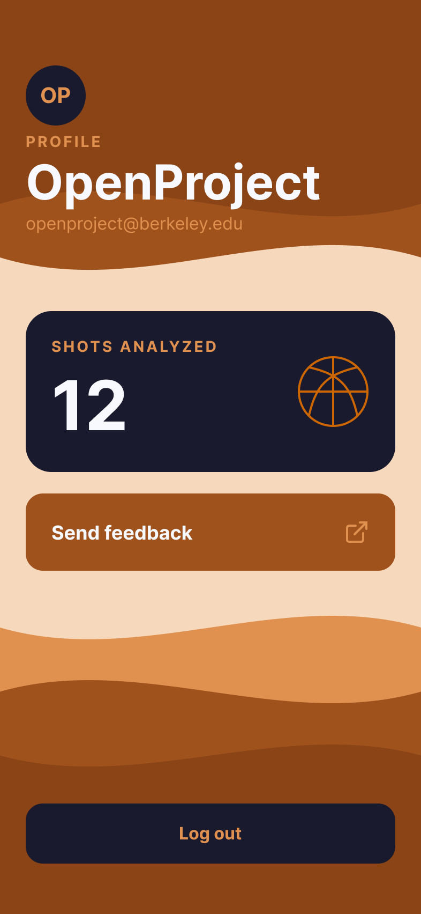

# Warriors #03: Profile screen

Figma: https://www.figma.com/design/0X9AQptTgWVXLYgKjfdB6M/Profile?node-id=1-2&t=sTcmmM3c858mzJ4q-1

- Mobile: 393 × 852 (iPhone 16)
- Shows the account avatar (initials), name, email, shots analyzed, a Send feedback row, and Log out.
- Name and email come from GET /auth/me. Shots analyzed is the number of sessions from getSessions and shows "—" while loading.
- Send feedback opens the beta Google Form from docs/beta-guide.md.
- Log out is a full-width navy button at the bottom. It calls logout() and the app returns to Login. No confirmation dialog, because Alert does not work on web.
- Font: Inter. Sizes: name 45 bold, shot count 64 bold, "Send feedback" 18 bold, email and body 16 regular, labels 14 bold with 2px letter spacing.
- Spacing: 24px side margins. Stat card 345 × 150, radius 24, padding 24. Feedback row 345 × 72, radius 16, padding 24. Log out button 345 × 56, radius 16. Avatar 56 × 56.
- Colors: dark rust #8A4416, rust #A0521D, light orange #E0914F, orange #CC6600, peach #F6D9BC, navy #1A1A2E, light text #F8F8FF.

Top and bottom waves use the style guide swirl in dark rust, rust, and light orange, layered over a peach middle section. Navy is used for the avatar, stat card, and Log out button so the key actions stand out against the orange. Labels and the email use light orange; headline text uses #F8F8FF for contrast. The basketball icon in the stat card is #CC6600.

The shot count of 12 and the "OpenProject" name and email are sample design values. The built screen shows the real user from /auth/me and the real session count.