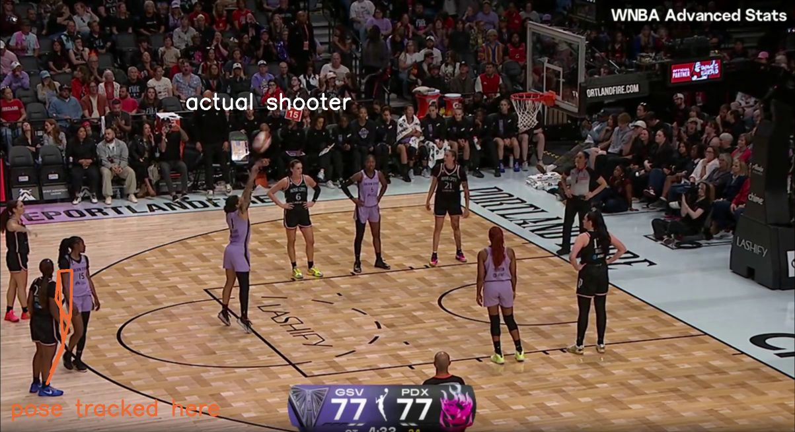
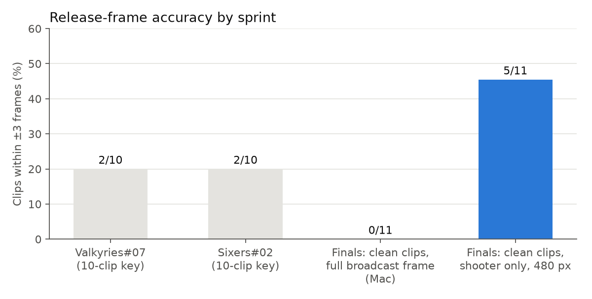
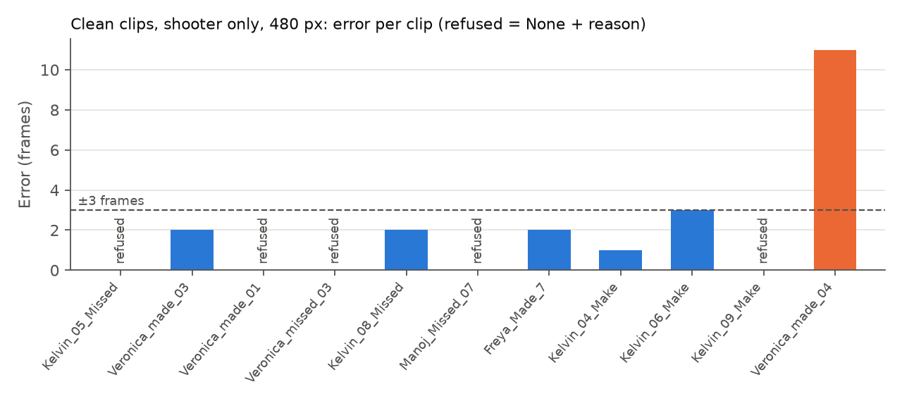
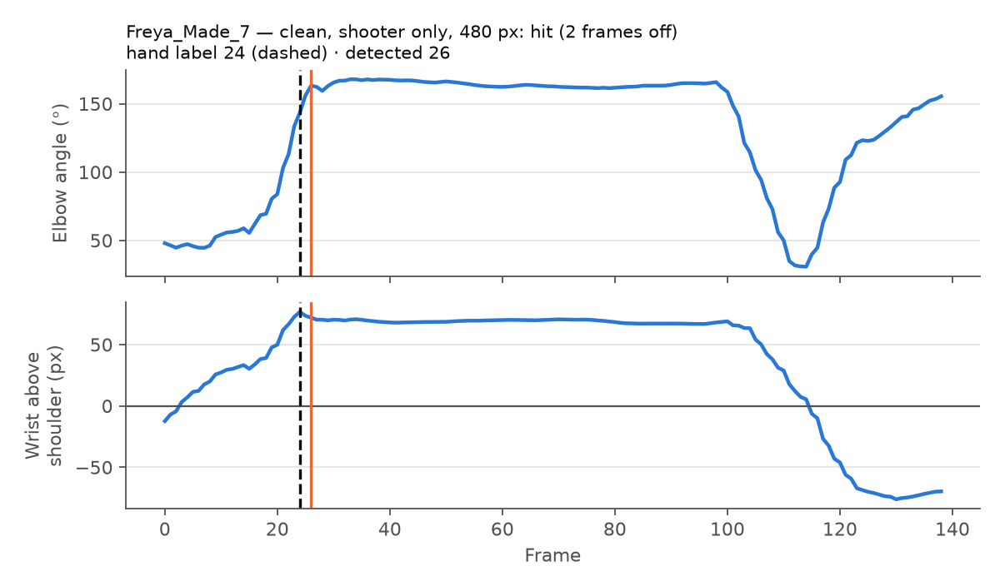
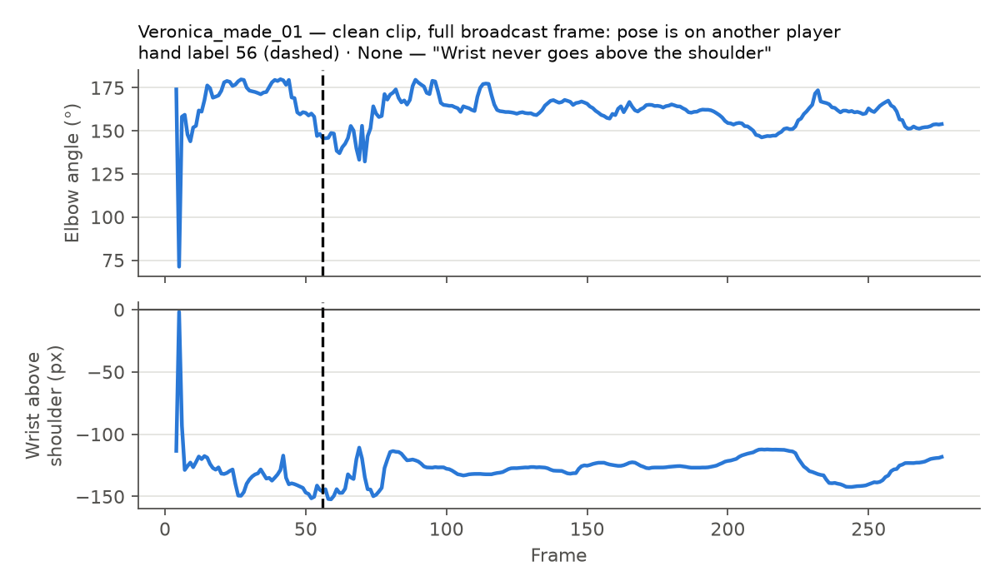
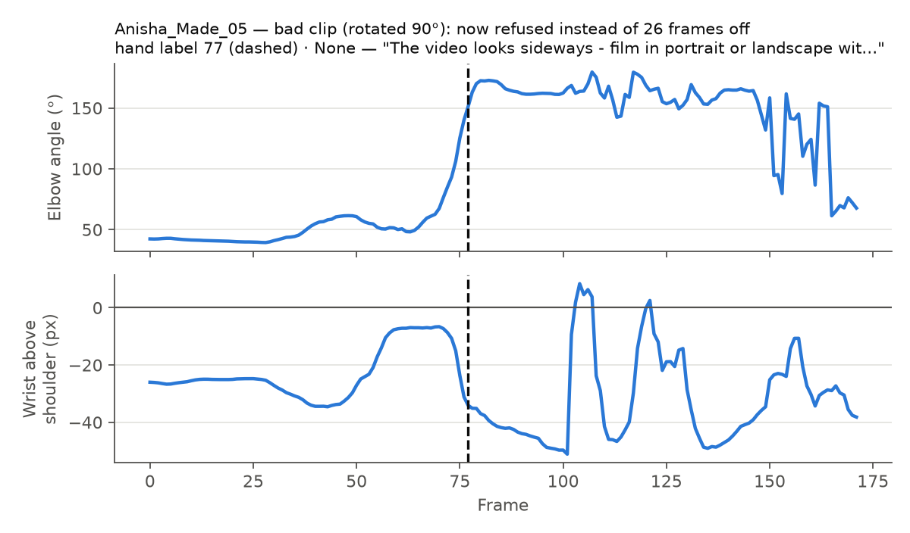

# How accurate is release detection? (Finals#04)

## Problem
The release-frame detector averaged about 22 frames off on the 10-clip answer key. That key mixed in junk footage: a spliced intro with a different person, rotated or blurry clips, and a flash. We didn't know whether the detector was bad or the test set was. "How accurate is it?" is the first question judges ask, so we needed an honest number before spending a sprint "fixing" detection.

## What we found
- **Clean answer key.** 11 clips picked on footage alone, before running the detector: whole body and ball in frame, side view, sharp at the release, one continuous take, not rotated. Each is hand-labeled with one rule: the first frame where there's a gap between ball and fingertips. Bad clips are flagged in `testing/test-videos.md` and kept for testing failure handling.
- **The release rule isn't the main problem.** All our test clips are NBA/WNBA broadcasts with 8 to 10 people in view, and MediaPipe Pose tracks one person, often a bystander. Every time the pose *was* on the shooter, the detected release was **2 frames** off.

- **So we took Path A.** The release rule stays as it is. The detector now **refuses instead of guessing** and returns `None` plus a filming tip when:
  - the video looks sideways (median shoulder→hip angle more than 45° from vertical), usually a phone clip whose rotation flag the decoder ignores
  - the tracked body jumps more than 2.5 torso lengths in one frame, or changes size more than 1.8×, *and stays there*, which means a cut or a switch to another person. One-frame glitches that snap back are ignored.
  - more than 5 frames of pose are missing within ±8 frames of the release

  I tuned the jump threshold on every run (49 detections). At 2.5 it refuses 1 of 19 correct answers and 7 of 30 wrong ones. At 1.5 it refused 4 correct answers.

## Numbers
| Footage | Within ±3 | Release found | Avg error when found |
|---|---|---|---|
| Old 10-clip key, Sixers#02 (Mac) | 2/10 | 9/10 | 22.0 |
| Clean clips, full broadcast frame, before | 2/11 | 6/11 | 51.3 |
| Clean clips, full broadcast frame, after (Path A) | 2/11 | 3/11 | 33.7 |
| **Clean clips, shooter only, 480 px (server size), after** | **5/11** | **6/11** | **3.5** |
| Bad clips (rotated / spliced), before → after | 0/4 → 0/4 | 4 → 1 | 26.0 → 15.0 |

Three of the four bad clips are now refused instead of being 15 to 40 frames off: both rotated clips, and the spliced Veronica_made_05.

**Debug plots** (elbow angle and wrist height; dashed = hand label, orange = detected):

## What bad footage does now
| Footage | Result |
|---|---|
| Rotated 90° | `None`: "The video looks sideways…" |
| Cut / someone else takes over | `None`: "The tracked person jumps or changes mid-clip…" |
| Pose lost around the release | `None`: "Pose lost near the release…" |

**Filming requirements** (for Finals#03's validator and the onboarding tips):
1. Film from the side, with the shooting arm toward the camera.
2. Keep your whole body and the ball in frame for the entire shot.
3. **Only the shooter in frame.** No teammates or defenders in view.
4. One continuous take with no intro or cuts. Don't rotate the phone mid-recording.
5. Normal speed (no slow-mo), steady phone, good light, so the fingertips are sharp at the release.

## What's left
- **Pose tracks the wrong person in crowded footage.** That's the biggest remaining error, and a person-switch is only caught if it happens *mid-clip*. A clip locked onto a bystander from the start still returns a wrong frame (Freya_Made_7 full frame: 97 off). Next step: run MediaPipe's multi-person `PoseLandmarker` and pick the body whose wrist rises above its head.
- **We have no real "one person, side-on" phone clips.** Every clip in the Drive is broadcast footage, and the shooter-only numbers come from crops of it. A short session filming teammates would give the true number.
- **The splice and intro check misses intros with no full-body pose.** Veronica_missed_04 opens on a face close-up and still returns a frame 15 off.
- **Results vary by machine.** MediaPipe output differs between Mac and Linux by a few frames, and sometimes found vs None. The accuracy test allows 2 clips of slack.
