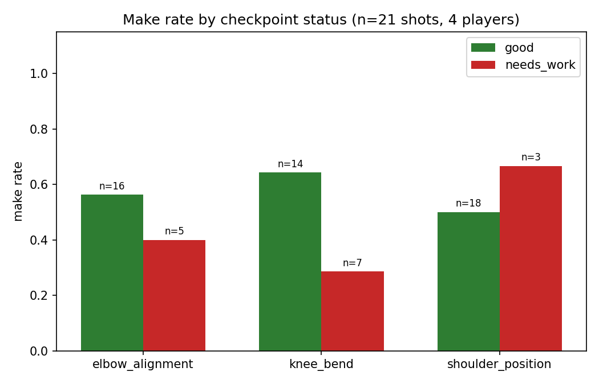

# Finals #09 Part 2 — do the app's form rules match real makes?

## Problem
The app tells shooters whether their elbow, knee, and shoulder angles at release are "good" or "needs work," and gives an overall form score. Nobody had actually checked whether shots the app calls good-form really go in more often than ones it flags.

## What we built / found
Using `data/features.csv`, we ran every shot's release-frame angles through the app's own `evaluate_form` function and compared make rates between "good" and "needs_work" shots for each checkpoint, then tested whether made shots score higher overall using a permutation test (10,000 shuffles).

With the current 21 shots: knee_bend showed the expected direction (good 0.64 make rate vs needs_work 0.29), elbow_alignment showed a smaller gap in the expected direction (0.56 vs 0.40), but shoulder_position went the wrong way (0.50 vs 0.67). Made shots scored only 2.6 points higher on average than missed shots, which a permutation test says is not remotely significant (p = 0.952).

**Important caveat:** in this 21-shot sample, player and outcome are completely confounded — every Abby/Anisha clip is a make, every Ryan/Veronica clip is a miss, because that's just how the clip zips happened to be organized for download. So none of the numbers above can actually answer the question yet; they could just as easily be measuring "which player" as "did the form rules work."

## Numbers
- 21 shots, 11 made / 10 missed, 4 players (Abby, Anisha, Ryan, Veronica)
- elbow_alignment: good 0.56 make rate (n=16) vs needs_work 0.40 (n=5)
- knee_bend: good 0.64 make rate (n=14) vs needs_work 0.29 (n=7)
- shoulder_position: good 0.50 make rate (n=18) vs needs_work 0.67 (n=3)
- made shots score 2.6 points higher on average, p = 0.952 (not significant)

## Pictures

## What's left
This needs to be re-run once the full ~185-clip dataset (currently blocked on getting the rest of Veronica's clip videos) is processed into features.csv, so players show up in both made and missed shots and the confound goes away. Until then, this result should not be treated as an answer to "does the app's advice match what makes shots go in" — it's inconclusive by construction.
