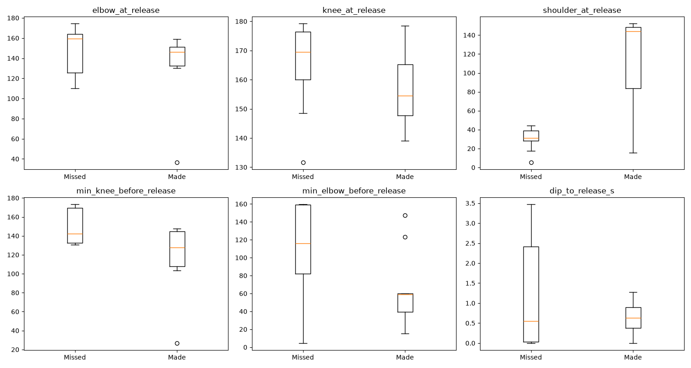
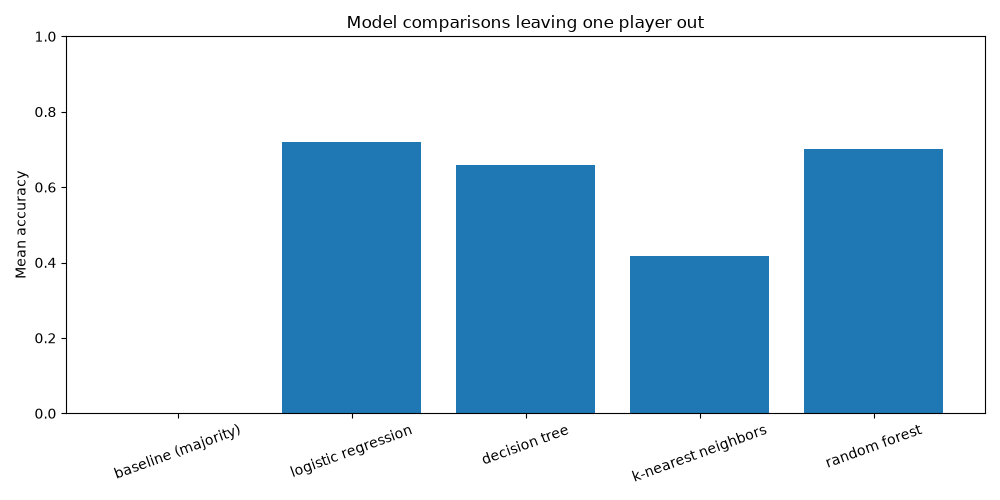
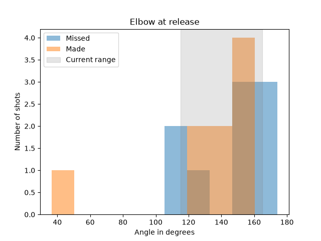
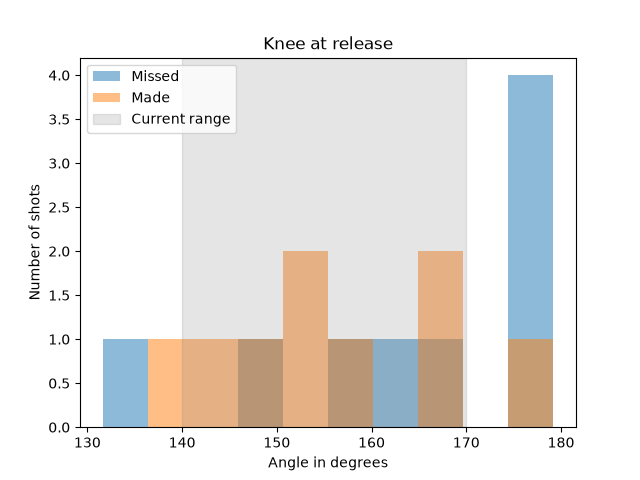
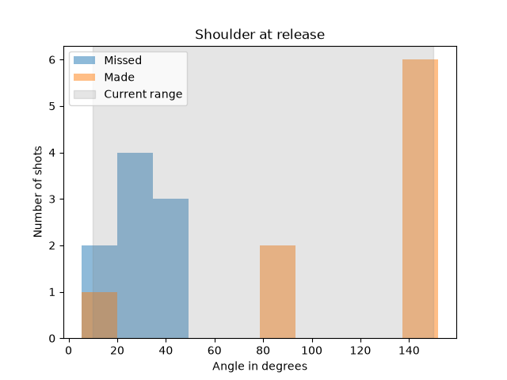

Experiments B: Predicting made and missed shots

    Problem: Finding which shooting form measurements were most associated with making a shot or whether form measurements can predict if a shot was made. Also to determine whether the app's current recommended angle ranges matched the measurements of successful shots.

    Findings: The dataset had 21 rows, and I dropped 3 rows with missing measurements, so there were 18 rows left (9 made, 9 missed). However, the player column didn't have the names of the people shooting in each video, it had the name of the person that uploaded the video. The 4 groups made from the player column therefore didn't represent the number of players, and LeaveOneGroupOut didn't work as intended. I still ran all the experiments using the player column as instructed, but for accurate results we'll need to separate the shots by actual players. Otherwise, the model could be trained and tested on shots from the same player, which could inflate the accuracy. All the results in this write-up are based on these 18 shots from an unknown number of players.

B1: Which angle matters most?

    Steps: I found the means and made box plots for each feature for made and missed shots. Then, I fitted a logistic regression on standardized features and ranked the coefficients by absolute value to compare all measurements.

    Findings: Shoulder angle was the feature that most strongly associated with a made shot, with the largest difference in means and the largest absolute coefficient. But since the results are only based on 18 shots, they are noisy.

    Numbers:
    - shoulder_at_release: 1.249
    - min_knee_before_release: -0.631
    - elbow_at_release: -0.438
    - min_elbow_before_release: -0.367
    - knee_at_release: -0.344
    - dip_to_release_s: -0.179
    
    The mean shoulder angle at release was 118.26 degrees for made shots and 30.22 degrees for missed shots, with a difference of 88.03 degrees.

B2, B3: Can angle measurements predict makes?

    Steps: I used LeaveOneGroupOut cross-validation to compare logistic regression, a decision tree (maximum depth of 3), k-nearest neighbors (k = 7), and a random forest (200 trees) against a majority baseline.

    Findings: Logistic regression performed the best, with a mean accuracy of 72%. When I saw that the majority baseline had an accuracy of 0%, I looked at the dataset to look into why and found that the player column has the name of the team member that uploaded the video. The dataset only had made shots from half the uploaders and missed shots from the other half. Every time I left out one group, it made the other option the majority in the training data, so the baseline predicted that one and was always wrong. So technically, all four models performed better than the baseline, but it had an accuracy of 0%, and the player column didn't reflect who was shooting in the video, so they may all have an inflated accuracy since the players we tested on might not be new players. There also aren't a lot of data points in the dataset I ran these tests on, so the results are noisy. So, I'm not able to determine whether angle measurements can predict if a new player made a shot.

    Numbers (mean accuracy and standard deviation after leaving out each group):
    - majority baseline: 0% ± 0%
    - logistic regression: 72% ± 6%
    - decision tree: 66% ± 11%
    - k-nearest neighbors: 42% ± 43%
    - random forest: 70% ± 21%

Do the current angle ranges match the measurements of made shots from the data:

    Steps: I made a histogram for made and missed shots for each of the three angles at release and shaded the current ranges on the same histogram. I used the 10th and 90th percentiles of the angle measurements from the made shots to suggest new ranges.

    Findings: The suggested elbow angle range was slightly lower than the current range, and the suggested knee angle range was almost the same as the current range. There was a lot of overlap between the measurements for made and missed shots for both angles. However, the shoulder angle range's suggested minimum was much higher than the current minimum, and a lot of the missed shots had shoulder angles within the current range. However, the suggested ranges are only based on 9 made shots, and we'd need to test on more before we can decide if we should change our current range.

    Numbers (angle ranges based on the 9 made shots):
    - elbow: 115–165 degrees (current), 111.52–154.80 degrees (based on data)
    - knee: 140–170 degrees (current), 142.54–169.62 degrees (based on data)
    - shoulder: 10–150 degrees (current), 69.22–149.86 degrees (based on data)
    

Future Steps/Notes:

    These tests were all run on the 18 row dataset, without the players that are shooting identified. For accurate results, we would need a full dataset and a way to identify the players. This way, the LeaveOneGroupOut test would work properly and the majority baseline comparison would be fixed.