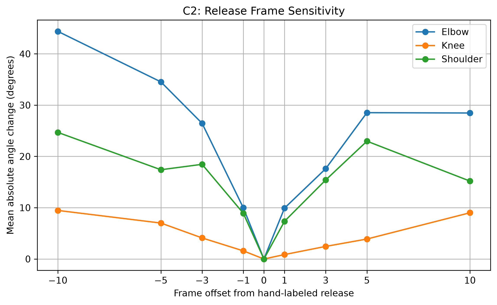
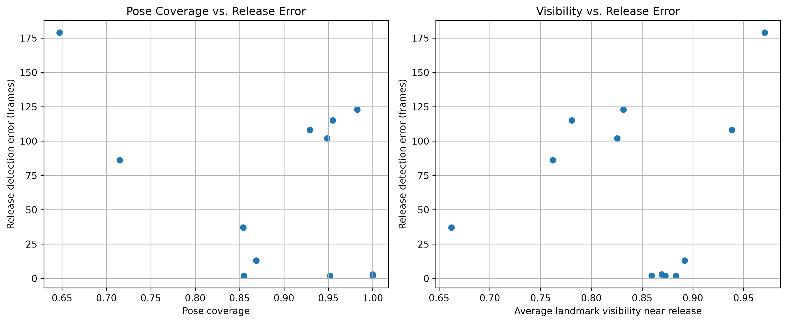

## C1: Logistic Regression Learning Curve

**Status: Blocked — insufficient data**

The goal of C1 was to evaluate how logistic regression accuracy changes with training set sizes of 10, 20, 40, 60, and 80 shots, using held-out players for evaluation.

However, the current `data/features.csv` contains only 8 labeled shots. This is fewer than the smallest requested training size (10 shots), so the experiment cannot be performed as specified.

We did not train a model or generate a learning curve because the available dataset is too small. This experiment can be completed once additional labeled shots are available.

## C2: Release Frame Sensitivity

### Methodology

We evaluated how errors in release-frame detection affect the elbow, knee, and shoulder angles extracted from basketball shooting videos. Using 20 clips with hand-labeled release frames, we extracted pose landmarks and calculated joint angles at the annotated release frame and at offsets of ±1, ±3, ±5, and ±10 frames.

For each offset, we calculated the absolute difference between the joint angle at the shifted frame and the angle at the hand-labeled release frame. We then averaged these differences across clips with valid measurements.

### Results

The elbow angle was the most sensitive to release-frame errors. A one-frame shift changed the elbow angle by approximately 10° on average, while a five-frame shift produced changes of approximately 29–35°.

The shoulder angle was also sensitive, changing by approximately 7–9° for a one-frame shift and 17–23° for a five-frame shift.

In comparison, knee angles were much more stable. A one-frame shift produced changes of approximately 1–2°, while five-frame shifts produced changes of approximately 4–7°.

### Limitations

Although all 20 clips were processed, four did not produce any valid angle comparisons. Additionally, some clips had missing joint angles at particular frame offsets, leaving 11–14 valid measurements per joint and offset.

Because the averages were calculated using available measurements, differences in sample composition may influence the results.

### Conclusion

Elbow and shoulder measurements are substantially more sensitive to release-frame timing errors than knee measurements. This suggests that improving release-frame detection accuracy could be particularly valuable for reliably evaluating upper-body shooting mechanics.

## C3: Pose Confidence vs. Release Detection Error

### Methodology

We investigated whether pose confidence was associated with the accuracy of automatic release-frame detection.

For each video, we calculated pose coverage as the proportion of frames containing detected pose landmarks. We also calculated average landmark visibility within five frames before and after the hand-labeled release frame.

We compared these measurements against the absolute difference between the automatically predicted release frame and the hand-labeled release frame.

### Results

Of the 15 videos evaluated, the release detector successfully returned predictions for 12 and failed on 3.

Among successful predictions, the average absolute release-frame error was 64.33 frames, with a median of 61.5 frames and a maximum of 179 frames.

Pose coverage showed a moderate negative correlation with release detection error (r = −0.424), suggesting that videos with more consistent pose tracking tended to have smaller detection errors.

In contrast, average landmark visibility near release showed a very weak positive correlation with detection error (r = 0.143), indicating little linear relationship between these measurements.

### Limitations

Five of the 20 videos were excluded because their shooting hands had not yet been confirmed. Additionally, three evaluated videos did not produce release-frame predictions and were excluded from the correlation calculations.

The visibility metric averaged all detected body landmarks rather than focusing specifically on the shooting arm. This may limit its usefulness for predicting the accuracy of a release detector that relies on arm movement.

The small sample size and large variation in release detection errors also limit the conclusions that can be drawn.

### Conclusion

Pose coverage showed some association with release detection accuracy, but average landmark visibility near release was not a strong predictor in this sample. These results suggest that reliable release detection may depend on factors beyond overall pose confidence, including the quality of specific shooting-arm landmarks and the detector's movement-based rules.

