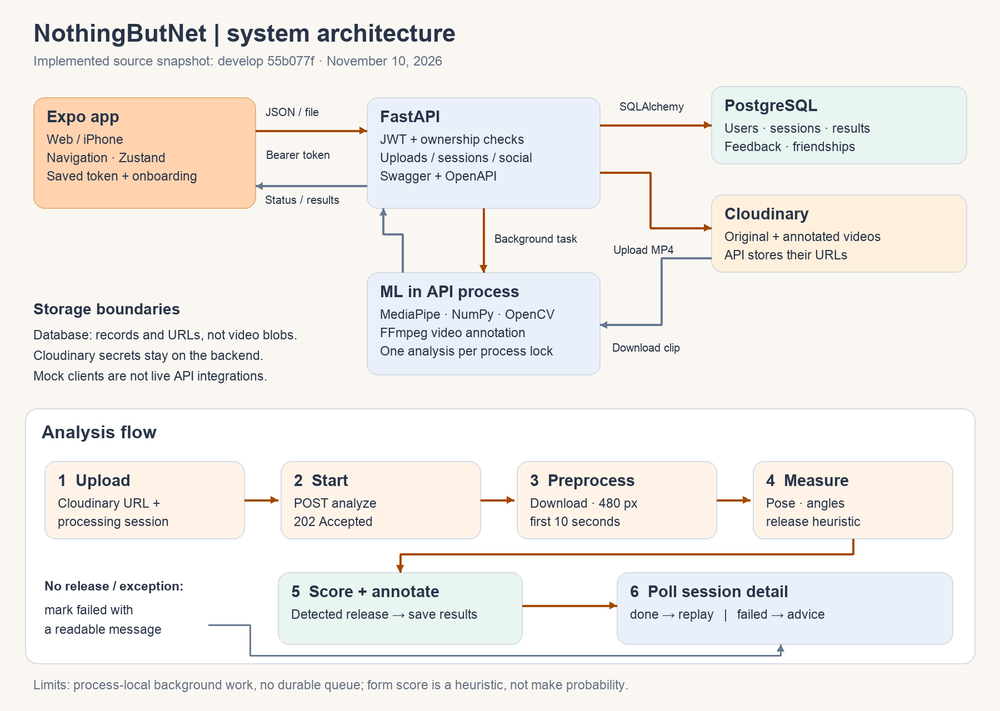

# NothingButNet — project write-up draft

**PM working draft, November 10, 2026.** Source snapshot: `develop` `55b077f`. Ayah/Navya finalize this for the showcase and presentation after the Finals tickets merge. `[X]` fields are intentionally unfilled; replace them only with measured results and links. This draft records implementation separately from unverified claims.

## Problem

Basketball players practicing without a coach can replay a free throw but may struggle to identify a concrete change in their shooting form. A useful practice tool should turn a short clip into understandable feedback, show the relevant body positions, and let the player compare later attempts without requiring specialized equipment.

## What we built

NothingButNet is an Expo/React Native app with a FastAPI backend and a pose-based video-analysis pipeline. Users upload a side-view free-throw clip, receive an annotated replay and elbow/knee/shoulder feedback, and review their shot history. First-launch onboarding explains filming requirements; persistent login reduces repeated setup. Profile/username, made/missed labeling, comparisons and social features extend the practice workflow, with some app integrations still mocked or pending registration at this snapshot.

We chose a modular pose-plus-rules pipeline to make feedback traceable to measured angles. It provides understandable checkpoints without claiming to have trained a validated shot-success predictor. PostgreSQL stores structured records while Cloudinary stores the larger video files. This split keeps the mobile app independent of the analysis implementation.

## Architecture and ML approach

The app sends authenticated JSON/multipart requests to FastAPI. An upload creates a session and stores its original video in Cloudinary. A separate analysis call returns 202 and starts background work; the app polls session detail until it is done or failed. PostgreSQL retains ownership, measurements, feedback, score and video URLs. Work is serialized within one API process rather than delegated to a durable queue. See [architecture](../architecture.md) and the [audited API contract](../api-contract.md).

The server resizes clips to at most 480 pixels wide and analyzes the first 10 seconds. MediaPipe Pose estimates landmarks, the pipeline detects the shooting side, measures three joint angles and chooses a release frame heuristically. Inclusive form ranges are elbow **85–100°**, knee **150–175°**, shoulder **45–75°**. Scoring starts at 100 and subtracts two points per degree outside each range, clamped to 0–100; missing angles are skipped. Skeleton/angle overlays make the result inspectable. These ranges and scores are assumptions to evaluate, not proof of correct biomechanics or a prediction that the ball goes in.

## Features and current limits

Implemented pieces include onboarding, saved login, upload/background analysis, annotated results, history, profile/username APIs, progress, comparisons, recurring-feedback logic, friend requests and made/missed storage. The release status table in the [README](../../README.md#what-is-implemented) distinguishes API implementation, mock-backed screens and navigator registration.

At this audit, signup's nested request shape disagrees with the app/older tests; real comparison reads fields from the wrong model; recurring insights uses the wrong feedback attribute; several social clients still return mocks. Friends UI PR #103 has not landed on audited develop and Friends/Leaderboard routes are unregistered. Goal/feedback CRUD, leaderboard API and session deletion are not implemented. PMs should update this paragraph after the feature owners' fixes merge, before describing the demo as end-to-end.

## Results — evidence and pending numbers

| Evidence | Result / source |
|---|---|
| Historical release accuracy, **not final** | 22.7-frame mean absolute error over 9 detected clips; 2/10 within ±2 frames; 1/10 missed detection. The historical answer key includes footage-quality concerns. [Valkyries report](../../testing/reports/accuracy.md). |
| Historical server preprocessing measurement | Local macOS test on one 12-second 1080×1920 clip: 24.8 s / 925 MB without shrinking vs 11.0 s / 383 MB at 480 px and 10 s. Different input duration/frame count; not a production benchmark. [Deployment notes](../deploy.md). |
| Current automated checks | Local full ML suite: **56 passed**. API: **35 passed, 3 failed, 4 errors**, driven by signup-shape mismatch. These checks are functional tests, not model-accuracy measurements. Hosted CI status belongs on the PR. |
| Finals #04: clean release evaluation | **[X]** clips / players; **[X]**-frame MAE; **[X]/[X]** within ±2 frames; **[X]** missed. Link to clean-answer-key report: **[X]**. |
| Finals #03: live performance/validator | Cold/warm **[X] / [X] s**, peak **[X] MB**; invalid-clip rejection **[X] s** on **[X]** clips. Report/environment: **[X]**. |
| Finals #09: dataset and rules vs makes | **[X]** labeled clips from **[X]** players; made/missed balance **[X]**; relationship/effect estimate **[X]** with uncertainty **[X]**. Report: **[X]**. |
| Finals #10: prediction/ranges | Player-held-out metric **[X]**, majority baseline **[X]**, strongest association **[X]**, range findings **[X]**. Split/leakage checks and report: **[X]**. |
| Finals #11: reliability/findings | Sample-size curve **[X]**, angle sensitivity to release offsets **[X]**, confidence/error relationship **[X]**. One-page findings summary: **[X]**. |

Report denominators, player counts, failure rates, evaluation conditions and uncertainty with final numbers. Don't promote the old 22.7-frame figure to the clean final estimate, quote an onboarding sample score as a metric, or infer causation from a made/missed correlation. No Finals experiment write-ups were present in `docs/writeups/` at this snapshot; PMs must incorporate them as they merge.

## What we learned

The app/server boundary needs executable tests: changing signup's wire shape broke existing callers even though its schema still looked reasonable. Mock screens helped parallel frontend work, but must be explicitly labeled until real integration is tested. Video quality and release timing influence every downstream angle; analysis failures and honest measurements are as valuable as attractive scores. Memory preprocessing improves feasibility on a small server, while its truncation and queue limits need clear user expectations.

## What's left

Finals #01/#02 connect social screens and fix app regressions; #03 hardens performance/video validation; #04 and #09–#11 supply final evaluation evidence; #05/#06 supply demo backups and full regression results; #07 completes security/privacy review. This ticket adds full-suite CI, setup/architecture docs and the corrected source contract. Its remaining sign-offs are hosted-green checks after upstream fixes, comparison with responsive live `/docs`, and an independent new-contributor walkthrough of [setup](../setup.md#verification-and-teammate-walkthrough).

## Team

Built by the NothingButNet team; PMs **Ayah and Navya**. [Contributor history](https://github.com/e-ayah/nothingbutnet/graphs/contributors) records implementation/design authors. Final names, roles and acknowledgments for the presentation: **[X — PM-confirmed roster]**. Include player consent/recording acknowledgments without publishing private participant data.
