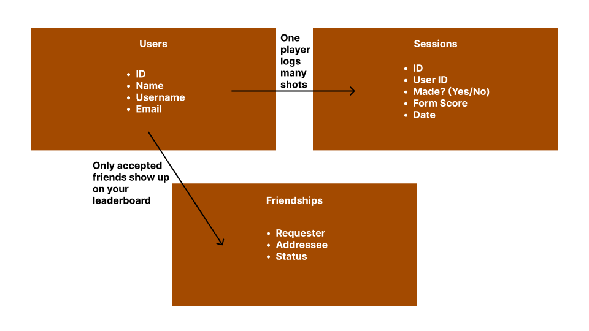
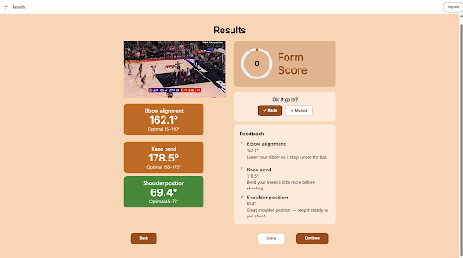
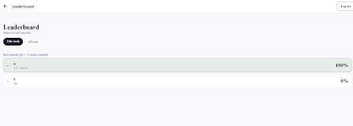
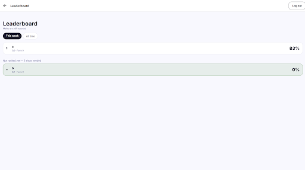
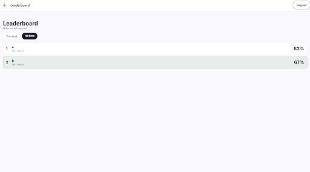
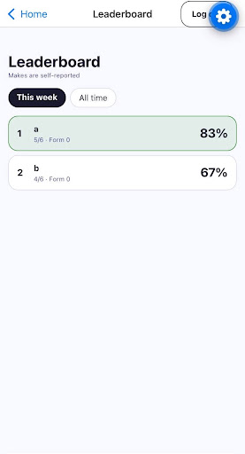

Problem
Before this change, NothingButNet's social features (Friends, shot outcomes, recurring form-mistake insights, and the Leaderboard) relied on hardcoded mock data on the frontend and lacked a live `GET /leaderboard` endpoint. Users could not see real make percentages among accepted friends or compare weekly versus all-time shooting consistency across web and iOS.

What was built/found
 Live Leaderboard API (`backend/routers/leaderboard.py`): Built `GET /leaderboard?period=week|all` for self-reported makes (`ShotSession.made is not None`) for the current user and accepted friends (`friend_ids()`). Enforced a 5-shot minimum (`MIN_SHOTS = 5`) for numerical ranking, breaking ties by total attempts (`-make_pct, -attempts`) and placing `< 5`-shot users at the bottom with `rank = null` (unranked)
Starter-Code Fixes Discovered: Updated the starter query to read `ShotSession.overall_score` directly instead of joining `AnalysisResult` (which lacks `overall_score` and would drop shots without an analysis row), and used `s.made is True` to satisfy SQLAlchemy static type checks
Live Frontend Wiring: Switched `USE_MOCK = false` across all social API clients (`leaderboardApi.ts`, `madeApi.ts`, `compareApi.ts`, and `insightsApi.ts`, where `insightsApi.ts` previously evaluated the truthy `MOCKS` config object instead of a boolean flag)
Privacy Rules: `GET /leaderboard` restricts queries strictly to `[user.id] + friend_ids(db, user.id)`. Pending requests, declined requests, and non-friends never appear, and user email addresses are never included in social payloads
End-to-End Findings & Filed Issues: Verified multi-account workflows on web and iOS and filed GitHub Issues for bugs discovered outside our owned files:
  1. `frontend/screens/Results.tsx`: `Back` and `Continue` buttons lack `onPress` handlers
  2. `backend/routers/sessions.py`: `GET /sessions/{session_id}` omits `made`, resetting `MadeToggle` visually when reopening `Results`
  3. `backend/routers/insights.py`: `GET /insights/recurring` references `r.checkpoint` instead of `r.checkpoint_name`
  4. CV pose pipeline: single-shooter clips fail analysis while multi-person court clips track background players instead of the shooter

Numbers
Unit & Integration Tests (`backend/tests/test_leaderboard.py`): 5/5 passed (`100%` pass rate) covering ranking order, the 5-shot minimum threshold, tie-breaking by shot volume, `week` (7-day window) vs. `all` time filtering, and non-friend/pending-request exclusion
Mock Elimination: Reduced active mock flags in social API services from 4/4 to 0/4
Multi-Account E2E Verification: Tested with 3 accounts, 2 accepted friendships and 1 non-accepted request, and 6+ logged shots per ranked user across web and iPhone

Pictures

What's left
Friends UI Integration (`PR #103`): Once `Friends.tsx` and `friendsApi.ts` merge into `develop`, flip `USE_MOCK = false` in `friendsApi.ts` and verify in-app friend requests end to end
Bug Fixes: Resolve the filed issues in `sessions.py` (return `made` on `GET /sessions/{id}`), `Results.tsx` (`Back`/`Continue` navigation), `insights.py` (`checkpoint_name`), and shooter isolation in the CV pose pipeline
